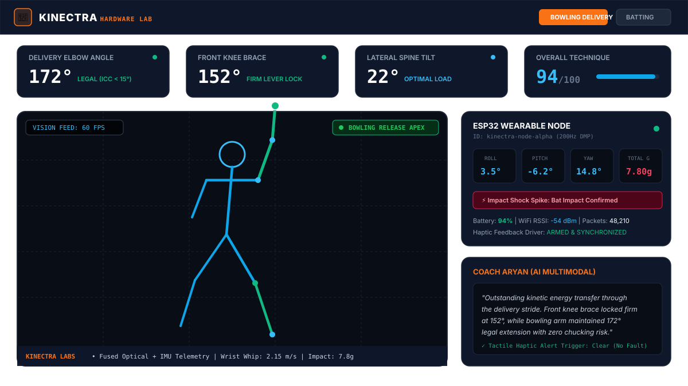
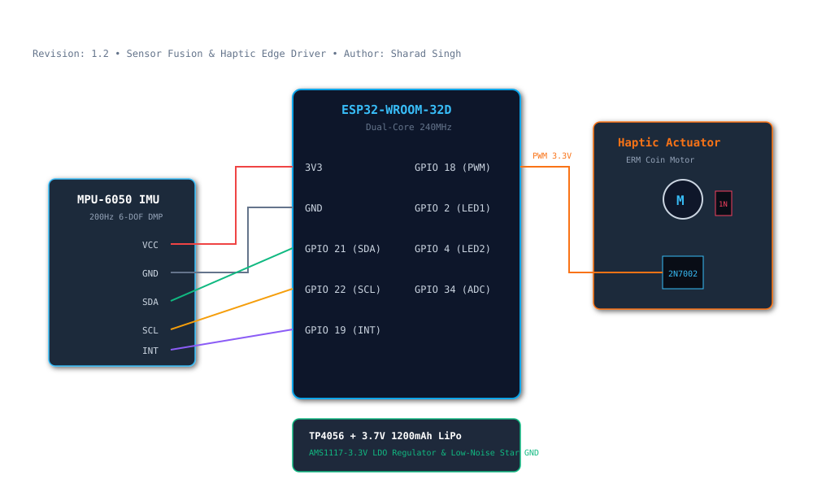
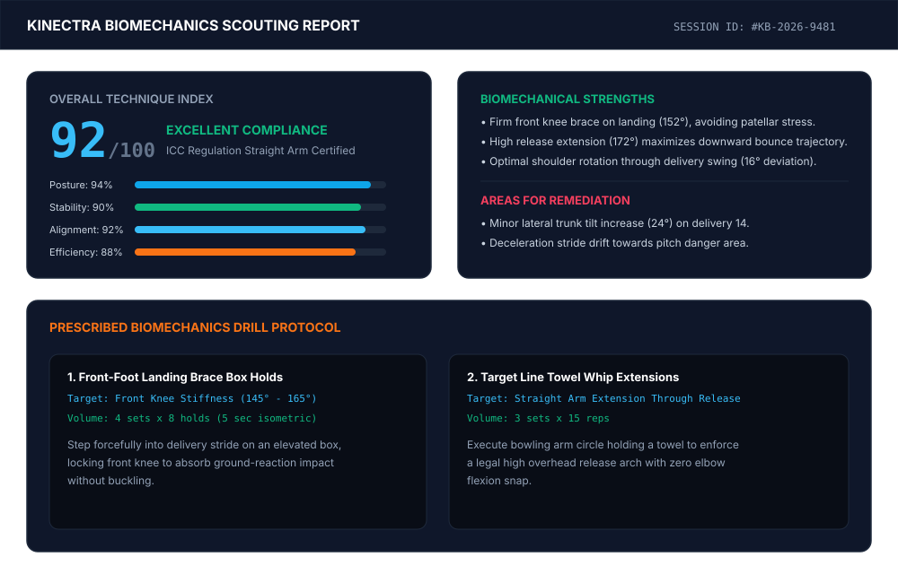

# Kinectra Prototype & Hardware Ecosystem 🏏⚡

> **Real-Time Edge-AI Sports Biomechanics, Wearable IMU Sensor Fusion & Automated Technique Coaching Engine**

[](LICENSE)
[](hardware/)
[](hardware/firmware/)
[](backend/)
[](frontend/)
[](ai/)

---

## 📌 1. Project Overview

**Kinectra** is a sports biomechanics engineering platform designed for cricket bowling delivery and batting stroke analysis. Combining custom high-frequency **IoT wearable IMU hardware** with **client-side optical computer vision** and **multimodal generative AI coaching**, Kinectra captures high-velocity athletic movements, diagnoses kinetic chain flaws, and delivers instant auditory and visual telemetry.

### Key Capabilities
- **200 Hz Wearable IMU Sensor Node**: Custom ESP32 hardware streaming Euler orientation, linear acceleration, and high-$g$ collision spikes ($> 6.5\text{ g}$) over low-latency WebSockets.
- **Real-Time Optical Pose Kinematics**: 33-point skeletal landmark tracking estimating Elbow, Knee, Spine, and Shoulder alignment in real time.
- **Sensor Fusion Gateway**: Synchronizes high-frequency inertial data with optical video frames, overcoming rolling shutter and motion blur at delivery speeds exceeding $120\text{ km/h}$.
- **Haptic Feedback Actuation**: Instantly pulses a wrist-mounted ERM vibration motor when illegal elbow flexion ($> 15^\circ$) or knee collapse occurs.
- **Coach Aryan (Multimodal AI)**: Generates sub-second spoken tactical coaching alerts and post-session biomechanics scouting reports.

---

## 🏗️ 2. Repository Architecture

```text
Kinectra-Prototype-Hardware/
├── README.md               # Master system documentation & integration guide
├── LICENSE                 # Open-source MIT License
├── hardware/               # IoT wearable & edge camera schematics, BOM, firmware
│   ├── components.md       # Full hardware bill of materials (BOM) & specs
│   ├── wiring.md           # Pinouts, circuit diagrams, and electrical schematics
│   └── firmware/           # ESP32 C++ PlatformIO firmware for 200Hz IMU streaming
│       ├── platformio.ini  # Build environments & library dependencies
│       ├── include/        # Pinouts, network settings & configuration
│       └── src/            # Dual-core FreeRTOS firmware source code
├── backend/                # Python FastAPI gateway, sensor fusion & video engine
│   ├── main.py             # Dual WebSocket server & REST API
│   ├── requirements.txt    # Python dependencies
│   └── README.md           # Backend service quickstart & API docs
├── frontend/               # React 19 + Vite + Tailwind telemetry dashboard
│   ├── package.json        # Frontend dependencies & build scripts
│   ├── vite.config.ts      # Vite configuration
│   ├── tsconfig.json       # TypeScript configuration
│   ├── index.html          # HTML5 entrypoint
│   ├── src/                # UI components, state management & canvas renderers
│   └── README.md           # UI components, state management & setup
├── ai/                     # LLM coaching prompts, schemas & scoring formulas
│   ├── prompts/            # Coach Aryan system prompts & deviation instructions
│   ├── schemas/            # JSON contracts for telemetry, alerts & reports
│   └── README.md           # AI reasoning engine & kinematic scoring model
├── docs/                   # Deep technical specifications & research disclosures
│   ├── architecture.md     # System flowcharts, network topology & sensor fusion
│   └── limitations.md      # Edge constraints, optical occlusion & mitigation
└── demo/                   # Telemetry captures, circuit diagrams & visual proof
    ├── README.md           # Demo walkthrough and asset catalog
    └── screenshots/        # High-resolution architectural & telemetry assets
        ├── telemetry_dashboard.svg   # Live dashboard UI visualizer
        ├── hardware_schematic.svg    # ESP32 + MPU6050 circuit schematic
        └── session_breakdown.svg     # Scouting report & drill prescription
```

---

## ⚡ 3. Quickstart & Operating Instructions

### Step 1: Flash ESP32 Wearable Firmware
```bash
cd hardware/firmware
pio run --target upload
```

### Step 2: Launch the Sensor Fusion Backend Gateway
```bash
cd backend
python -m venv venv
# Windows: .\venv\Scripts\activate | Linux/macOS: source venv/bin/activate
pip install -r requirements.txt
python main.py
```
*Gateway running at `http://localhost:8000` (API docs at `/docs`)*

### Step 3: Run the React Telemetry Dashboard
```bash
cd frontend
npm install # or pnpm install
npm run dev
```
*Dashboard running at `http://localhost:3000`*

---

## 📊 4. System Telemetry & Circuit Schematics

### Real-Time Biomechanics Dashboard


### Circuit Wiring & Microcontroller Schematics


### Post-Session Biomechanics Scouting Report


---

## 📐 5. Biomechanical Scoring Formula

Kinectra calculates technique efficiency across four primary kinematic indicators:

$$S_{\text{overall}} = 0.30 \cdot S_{\text{posture}} + 0.25 \cdot S_{\text{alignment}} + 0.25 \cdot S_{\text{stability}} + 0.20 \cdot S_{\text{efficiency}}$$

- **Posture ($S_{\text{posture}}$)**: Elbow extension legal boundary compliance ($165^\circ\text{--}180^\circ$) and neutral spine posture.
- **Alignment ($S_{\text{alignment}}$)**: Shoulder rotational vector relative to target delivery line.
- **Stability ($S_{\text{stability}}$)**: Firm landing knee brace ($140^\circ\text{--}165^\circ$) for kinetic energy absorption.
- **Efficiency ($S_{\text{efficiency}}$)**: Fused IMU and optical wrist whip acceleration ($> 1.8\text{ m/s}$).

---

## 📄 License & Attribution

Distributed under the **MIT License**. See [`LICENSE`](LICENSE) for full details.

Developed with precision by **Sharad Singh** ([@sharad619619](https://github.com/sharad619619)).
